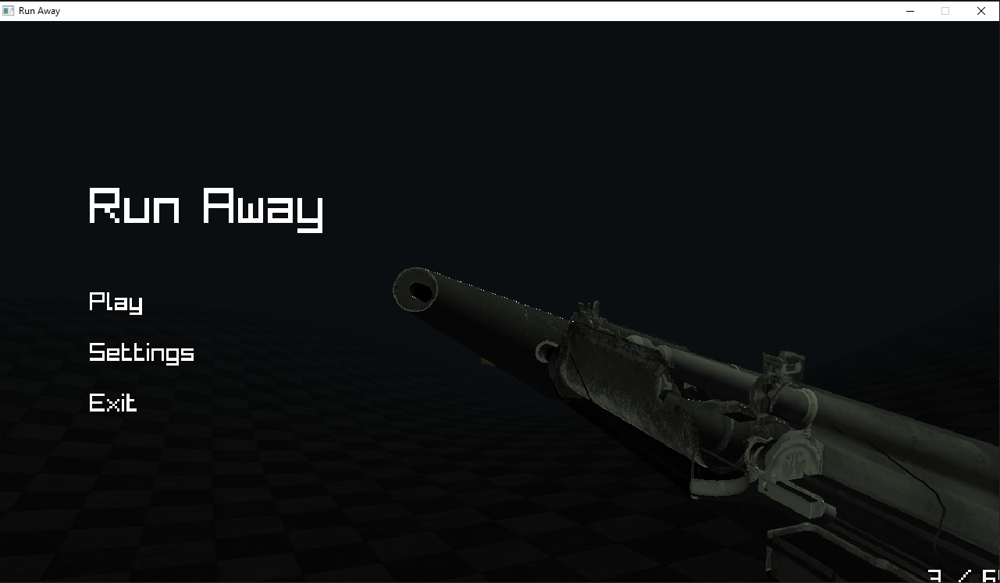
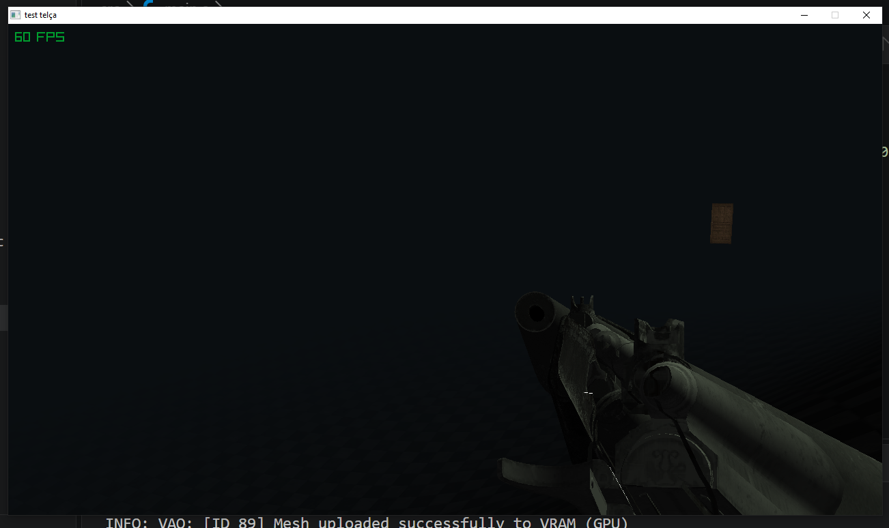

# Run-Away

A shooting game developed without an engine.

# Description

You were sleeping and woke up in a world full of elevations where there is only one door in the center; the only solution is for you to enter it, or you will remain in the dimension of nothingness.

# Controls

- W = Walk forward
- S = Walk backward
- A = Walk left
- D = Walk right
- R = Reload weapon
- Mouse = Camera Movement
- Mouse Left = Shoot
- F1 = Debug Mode Weapon

# Getting Started

## Dependencies

- Windows 10 or later 
- Linux
- Mac OS

## Instaling 
- To download the program, go to releases and look for the latest version of the project, or go to the itch.io page to download it by clicking [here](https://o-devzin.itch.io/run-away)

# Technologies used

- C
- Raylib

# Licence
