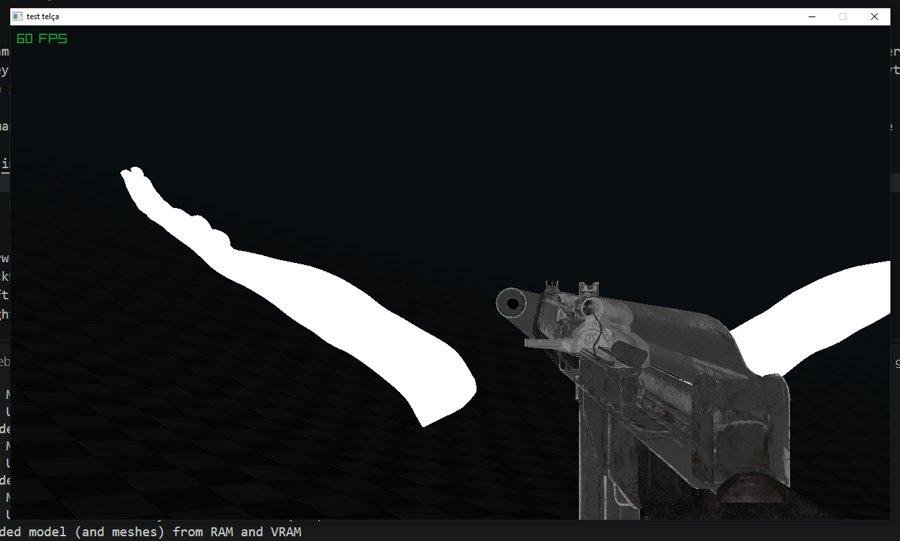

# Run-Away

This is a game where your objective is to escape this endless place, but to do so you'll have to kill zombies, search houses, everywhere for a key. This key will open a portal that will take you out of that suffering, but it's not so easy to get (I haven't completed everything yet, but I have a good part done, I'm sending it just to count the hours!).

The game's map is generated with some elevation changes, but I'll change that in the future, I'll make it flat to add houses more easily.

# Controls

W = Walk forward
S = Walk backward
A = Walk left
D = Walk right

To test the project (I don't recommend it, it's not very good, but just open game.exe)

Please note, this is not the final version; I'm still working on the game. This is just to keep track of the hours :)